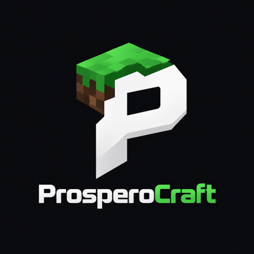
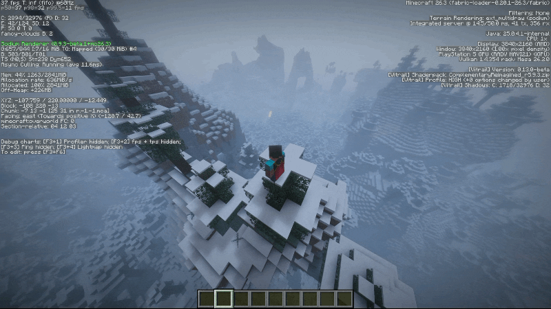
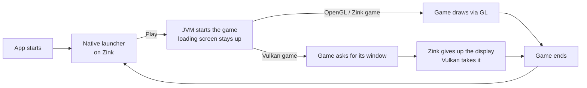

<div align="center">



# ProsperoCraft

**Minecraft: Java Edition on a PS5 with homebrew** — a controller-driven launcher, a real JVM, and three renderers.


[](https://ko-fi.com/tmghd272)



<sub><i>Captured on a base-model PS5 running Minecraft Java 26.3 with Fabric and the Complementary Shaders (Reimagined), at a render distance of 32 and a 4K render resolution.</i></sub>

</div>

A non-commercial, hobby launcher and runtime for **Minecraft: Java Edition** on a PS5 with homebrew support. Written and maintained by one developer as a personal project: no ads, no monetization.

## Features

- **Native launcher** (C++, controller driven): instances, version and mod management, settings, loading screen.
- **Many versions**: Minecraft 1.x up to 26.3, each on the Java it needs (8 / 17 / 21 / 25, chosen automatically).
- **Mods**: Fabric (recommended), Quilt, Forge and NeoForge, with automatic fitting: mods that do not suit the version or the console are set aside and come back when they do. Modrinth mods work; CurseForge is not implemented yet.
- **Three renderers**, chosen in the launcher:

  | Renderer | What it is | Good for |
  |---|---|---|
  | OpenGL | the console's OpenGL SDK | older versions, lowest overhead |
  | OpenGL via Zink | OpenGL on Mesa Zink over RADV (Vulkan) | newer versions, shader packs |
  | Vulkan | Minecraft's own Vulkan backend (26.2+), or VulkanMod | the newest versions |

- **Zink launcher → Vulkan game without restarting the app**: the launcher's loading screen stays up while the game starts, then the display changes hands.
- **Input**: DualSense controller, or a **USB keyboard and mouse** (see [Input](#input)).
- **One global Memory setting** in the launcher (up to 8 GB).

## Input

- **USB keyboard and mouse** are supported. Plug them into the console and play like on a PC (look, scroll, drag, typing in chat and menus).
- **DualSense controller**: it is emulated as a keyboard and mouse (the touchpad moves the cursor), so it works in every version, including ones with no controller support.
- Mods that replace the input layer (for example Ixeris and Controlify) fight with this emulation, so the launcher sets them aside automatically.

## Mod loaders

| Loader | Status |
|---|---|
| **Fabric** (recommended) | The most tested. It has been used across many versions since the start of the project, and over 50 mods have been tried with it. |
| **Forge / Quilt** | Should mostly work, but they received much less debugging. Expect many mods to crash. |
| **NeoForge** | Never debugged or tested. It probably won't work for now. |

Mod sources: **Modrinth** mods work today. **CurseForge** is not properly implemented yet.

## Recommended setups

| | Vulkan | Zink | OpenGL |
|---|---|---|---|
| **Minecraft** | 26.2 – 26.3 | 1.20+ | 1.0+ |
| **Loader** | Vanilla, Fabric | Vanilla, Fabric | Vanilla, Fabric, Forge |
| **Mods** | Fabric API, Sodium, Vitrail Shaders | Fabric API, Sodium, Iris Shaders | any that suit your version |
| **Shaders** | Complementary, Sildur's or others | Complementary, Sildur's or others | not recommended |

## Renderers: what to expect

**OpenGL** has the broadest compatibility with versions and mods, and the launcher runs on it. Its performance is low, though, and shader packs will lag badly. It is generally stable and rarely freezes or crashes unless performance is the cause.

**Zink (OpenGL on Vulkan)** also works with the launcher and with any version, supports the same mods as OpenGL, and performs very well, close to native Vulkan. Its biggest drawback is random freezes or crashes, and the launcher can lag after you exit Minecraft back to it.

**Vulkan** has limited compatibility but works great on the versions with a native Vulkan backend, 26.2 – 26.3. In my testing it has not frozen or crashed during gameplay. Modded Vulkan through **VulkanMod** works too, but it was tested mainly on 26.1.x, so expect minor stutters or crashes on other versions.

## Accounts and multiplayer

Microsoft sign-in is currently a **placeholder in the source code**. Official multiplayer servers do work (I tested it), but I excluded login support. I won't go into more detail than that; that's how it is for now. You can still play in **offline mode** and over **LAN multiplayer**.

The project does not include or distribute Minecraft game files: they are downloaded from Mojang's own servers at runtime, as the official launcher does. It does not bypass ownership checks.

## Project status

This project is **paused** and probably won't get updates for a long time, because my Claude Pro subscription ran out. That is why I'm publishing it as it is. I know about the remaining bugs. I tried my best to make it playable and authentic without turning it into AI slop, but my time has run out. I spent almost 30 days of my entire Claude usage on this, just for the fun of it. Thank you for checking it out.

Console-tested: Minecraft Java from 1.x up to 26.3 on OpenGL, OpenGL via Zink and Vulkan; Fabric mods; the launcher, instances and the global memory setting; starting a Vulkan game from the Zink launcher without restarting the app. Known open items are listed in [docs/ai/HANDOFF.md](docs/ai/HANDOFF.md).

## How it starts



## Repository layout

```
src/host      the JVM host (jvm_host.cpp): config, heap, crash reporter, return to launcher
src/shim      LWJGL / GLFW / SDL / Vulkan shim (C): window, input, audio, GL and Vulkan layers
src/java      game launch, mod fitting, sign-in, downloads, launcher logic
src/awtlite   minimal AWT for mods        src/lwjgl2   LWJGL 2 port for old versions
launcher/     the native launcher UI (C++, GPL-3)
title/        the title boilerplate this is built on (vendored, see title/FROM_UPSTREAM.md)
third_party/  the files we edited from other projects, stored whole
tools/        build.sh, sync.sh, setup.sh, build and debug scripts
config/       log4j2 and mod option defaults
tests/        sandbox tests (no console needed)
docs/         BUILDING.md, ARCHITECTURE.md, ai/ (notes for AI assistants)
```

## Build

Needs WSL, the PS5 payload SDK and the Vulkan project, see [docs/BUILDING.md](docs/BUILDING.md). `MSA_CLIENT_ID` is only needed for the (placeholder) Microsoft sign-in code and can be left out:

```
MSA_CLIENT_ID=<your Azure app id> bash tools/build.sh <PC ip> <PS5 ip>
```

Design notes: [docs/ARCHITECTURE.md](docs/ARCHITECTURE.md). Continuing this with an AI assistant? Start from [docs/ai/HANDOFF.md](docs/ai/HANDOFF.md) and [docs/ai/NEW_CHAT_PROMPT.md](docs/ai/NEW_CHAT_PROMPT.md).

## Credits

ProsperoCraft stands on a lot of other people's work:
[ps5-payload-dev/sdk](https://github.com/ps5-payload-dev/sdk) (PS5 toolchain) · [mihawk-99/PS5_Vulkan](https://github.com/mihawk-99/PS5_Vulkan) (RADV on the console) · BlackBearReloaded (the Kit launcher UI and the native app boilerplate, GPL-3) · SvenGDK's SharpProspero (ELF/FSELF tooling in the boilerplate) · [LWJGL](https://www.lwjgl.org/) · [gl4es](https://github.com/ptitSeb/gl4es) (ptitSeb) · [Mesa / Zink](https://www.mesa3d.org/) · [OpenJDK](https://openjdk.org/) · [FreeType](https://freetype.org/) · [libffi](https://github.com/libffi/libffi). Full notices for the boilerplate: [title/THIRD_PARTY_NOTICES.md](title/THIRD_PARTY_NOTICES.md).

## Disclaimer

ProsperoCraft is an unofficial, non-commercial hobby project. It is **not affiliated with or endorsed by** Mojang Studios, Microsoft or Sony Interactive Entertainment. Minecraft is a trademark of Mojang Synergies AB. It contains no Minecraft game files, and you need your own copy of the game to play online. You use it at your own risk; running homebrew on a console is your own decision and responsibility. The software is provided "as is", without warranty of any kind, and there is no support or timeline for fixes.

## Support

<div align="center">

**Enjoying ProsperoCraft?** It was built for fun, and a coffee helps.

[](https://ko-fi.com/tmghd272)

</div>
