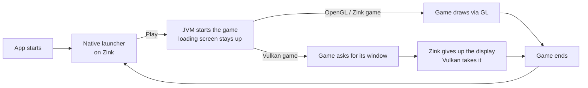

<div align="center">

# ProsperoCraft

**Minecraft: Java Edition on a PS5 with homebrew** — a controller-driven launcher, a real JVM, and three renderers.


</div>

A non-commercial, hobby launcher and runtime for **Minecraft: Java Edition** on a PS5 with homebrew support. Written and maintained by one developer as a personal project: no ads, no monetization.

## Features

- **Native launcher** (C++, controller driven): instances, version and mod management, Microsoft sign-in, settings, loading screen.
- **Many versions**: Minecraft 1.x up to 26.3, each on the Java it needs (8 / 17 / 21 / 25, chosen automatically).
- **Mods**: Fabric, Quilt, Forge and NeoForge, with automatic fitting (mods that do not suit the version or the console are set aside and come back when they do).
- **Three renderers**, chosen in the launcher:

  | Renderer | What it is | Good for |
  |---|---|---|
  | OpenGL | the console's OpenGL SDK | older versions, lowest overhead |
  | OpenGL via Zink | OpenGL on Mesa Zink over RADV (Vulkan) | newer versions, shader packs |
  | Vulkan | Minecraft's own Vulkan backend (26.2+), or VulkanMod | the newest versions |

- **Zink launcher → Vulkan game without restarting the app**: the launcher's loading screen stays up while the game starts, then the display changes hands.
- **Controller emulation**: the DualSense acts as keyboard and mouse (touchpad = cursor); USB keyboard and mouse work too.
- **One global Memory setting** in the launcher (up to 8 GB).

## What it does not do

- It does **not** include or distribute Minecraft game files. They are downloaded from Mojang's own servers at runtime, as the official launcher does.
- It does **not** bypass ownership checks. Online play requires a Microsoft account that owns Minecraft: Java Edition. A local offline mode (username only) exists, like the game's own.

## Microsoft sign-in

Standard Microsoft device-code flow (scope `XboxLive.signin offline_access`), then the usual chain: Microsoft OAuth device code → Xbox Live token → XSTS → `api.minecraftservices.com` `login_with_xbox` → profile lookup. It is a public client (no client secret). The only thing stored is the player's own refresh token, on their own device. The Azure app registration is named **ConsoleCraft**; its application id is not in this repository, you supply your own at build time (`MSA_CLIENT_ID`).

## How it starts



## Repository layout

```
src/host      the JVM host (jvm_host.cpp): config, heap, crash reporter, return to launcher
src/shim      LWJGL / GLFW / SDL / Vulkan shim (C): window, input, audio, GL and Vulkan layers
src/java      game launch, mod fitting, sign-in, downloads, launcher logic
src/awtlite   minimal AWT for mods        src/lwjgl2   LWJGL 2 port for old versions
launcher/     the native launcher UI (C++, GPL-3)
title/        the title boilerplate this is built on (vendored, see title/FROM_UPSTREAM.md)
third_party/  the files we edited from other projects, stored whole
tools/        build.sh, sync.sh, setup.sh, build and debug scripts
config/       log4j2 and mod option defaults
tests/        sandbox tests (no console needed)
docs/         BUILDING.md, ARCHITECTURE.md, ai/ (notes for AI assistants)
```

## Build

Needs WSL, the PS5 payload SDK and the Vulkan project, see [docs/BUILDING.md](docs/BUILDING.md):

```
MSA_CLIENT_ID=<your Azure app id> bash tools/build.sh <PC ip> <PS5 ip>
```

Design notes: [docs/ARCHITECTURE.md](docs/ARCHITECTURE.md). Continuing this with an AI assistant? Start from [docs/ai/HANDOFF.md](docs/ai/HANDOFF.md) and [docs/ai/NEW_CHAT_PROMPT.md](docs/ai/NEW_CHAT_PROMPT.md).

## Status

Work in progress. Console-tested: Minecraft Java from 1.x up to 26.3 on OpenGL, OpenGL via Zink and Vulkan; Fabric / Quilt / Forge / NeoForge mods; the launcher, instances, Microsoft sign-in and the global memory setting; starting a Vulkan game from the Zink launcher without restarting the app. Known open items are listed in [docs/ai/HANDOFF.md](docs/ai/HANDOFF.md).

## Credits

ProsperoCraft stands on a lot of other people's work:
[ps5-payload-dev/sdk](https://github.com/ps5-payload-dev/sdk) (PS5 toolchain) · [mihawk-99/PS5_Vulkan](https://github.com/mihawk-99/PS5_Vulkan) (RADV on the console) · BlackBearReloaded (the Kit launcher UI and the native app boilerplate, GPL-3) · SvenGDK's SharpProspero (ELF/FSELF tooling in the boilerplate) · [LWJGL](https://www.lwjgl.org/) · [gl4es](https://github.com/ptitSeb/gl4es) (ptitSeb) · [Mesa / Zink](https://www.mesa3d.org/) · [OpenJDK](https://openjdk.org/) · [FreeType](https://freetype.org/) · [libffi](https://github.com/libffi/libffi). Full notices for the boilerplate: [title/THIRD_PARTY_NOTICES.md](title/THIRD_PARTY_NOTICES.md).

*Not affiliated with Mojang Studios, Microsoft, or Sony Interactive Entertainment. Minecraft is a trademark of Mojang Synergies AB.*
